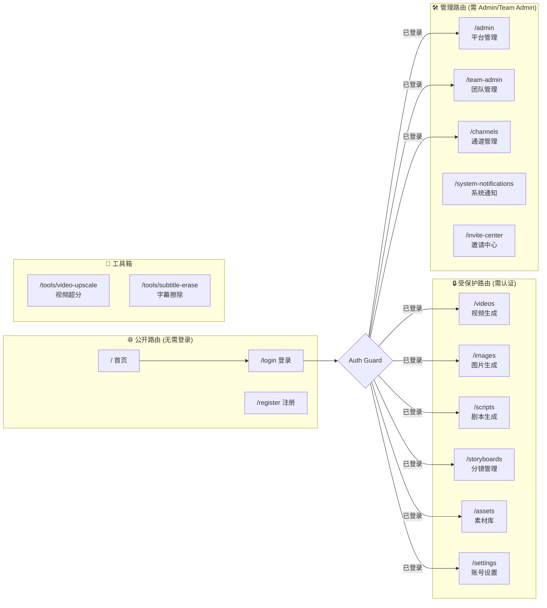
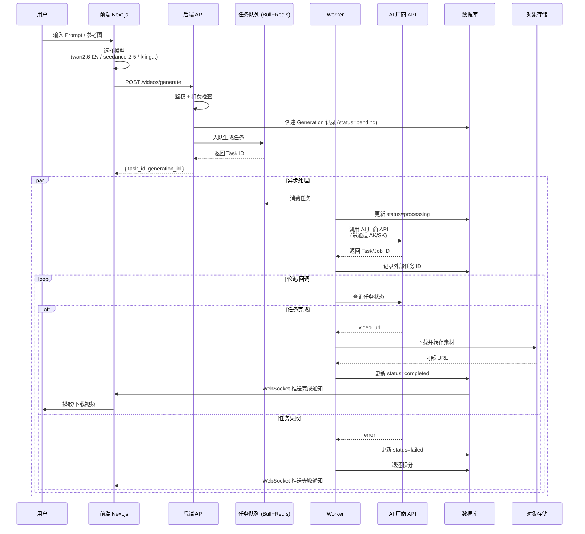
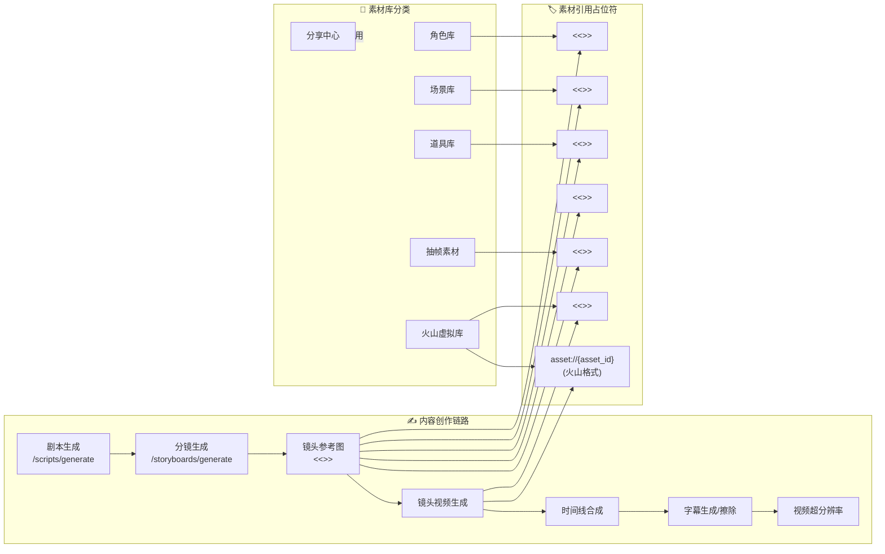
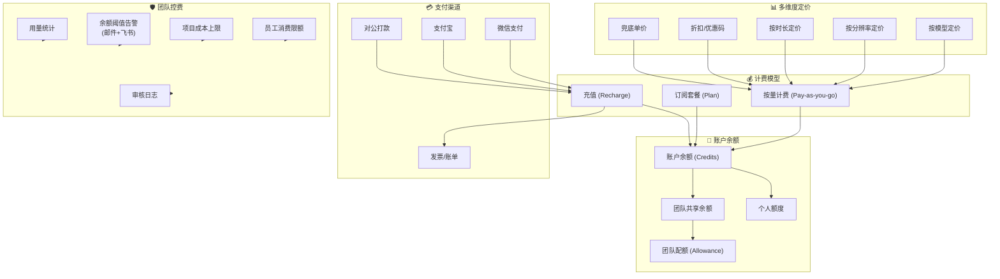

# Star AI 系统架构分析报告

> **目标站点**：`https://ai.lfxqai.com`  
> **平台定位**：AI 短剧生产平台（SaaS 多租户）  
> **前端框架**：Next.js 14+（App Router + Turbopack）  
> **分析时间**：2026-10-07  
> **分析方式**：前端 JS 逆向扫描 + RSC Payload 解析 + HTTP 路由探测

---

## 目录

- [一、系统总览架构图](#一系统总览架构图)
- [二、前端路由结构图](#二前端路由结构图)
- [三、认证与权限体系](#三认证与权限体系)
- [四、AI 模型提供商集成架构](#四ai-模型提供商集成架构)
- [五、视频生成核心业务流程](#五视频生成核心业务流程)
- [六、分镜/剧本/素材业务链路](#六分镜剧本素材业务链路)
- [七、计费与订阅体系](#七计费与订阅体系)
- [八、技术栈全景图](#八技术栈全景图)
- [九、数据库实体关系（推断）](#九数据库实体关系推断)
- [十、关键配置项清单](#十关键配置项清单)
- [十一、权限标识符完整列表](#十一权限标识符完整列表)
- [十二、架构关键特征总结](#十二架构关键特征总结)
- [附录：API 端点汇总](#附录api-端点汇总)
- [附录：发现的全部 AI 模型](#附录发现的全部-ai-模型)

---

## 一、系统总览架构图

```mermaid
graph TB
    subgraph 用户层["👥 用户层"]
        User["终端用户 / 团队成员"]
        Admin["平台管理员"]
        TeamAdmin["团队管理员"]
    end

    subgraph 接入层["🌐 接入层"]
        CDN["CDN / 静态资源加速"]
        LB["负载均衡 (Nginx/Caddy)"]
        WAF["WAF 防火墙"]
    end

    subgraph 前端层["💻 前端 (Next.js App Router)"]
        direction TB
        FE["Next.js 14+ 前端"]
        FE --> Pages["页面路由"]
        FE --> Components["UI 组件库"]
        FE --> State["状态管理"]
        FE --> i18n["国际化 zh-CN / en-US"]
        FE --> WS["WebSocket 实时通信"]
    end

    subgraph 后端层["⚙️ 后端服务 (Node.js)"]
        direction TB
        API["REST API 网关"]
        Auth["认证中心"]
        RBAC["RBAC 权限"]
        TaskQueue["任务队列 (Bull/Redis)"]
        Worker["异步 Worker"]
        
        API --> Auth
        API --> RBAC
        API --> TaskQueue
        TaskQueue --> Worker
    end

    subgraph 业务模块["📦 业务模块"]
        VideoGen["视频生成"]
        ImageGen["图片生成"]
        ScriptGen["剧本生成"]
        Storyboard["分镜管理"]
        AssetLib["素材库"]
        ModelMgr["模型/通道管理"]
        Billing["计费/订阅"]
        TeamMgr["团队管理"]
        AdminPanel["管理后台"]
    end

    subgraph AI 厂商 API["🤖 外部 AI 厂商"]
        direction LR
        Doubao["字节/火山<br/>豆包 Seedance"]
        Wanx["阿里/通义<br/>万相 Wan2.x"]
        Kling["快手<br/>可灵 Kling"]
        Sora["OpenAI<br/>Sora"]
        Veo["Google<br/>Veo"]
    end

    subgraph 数据层["💾 数据层"]
        DB["主数据库"]
        Cache["Redis 缓存"]
        ObjStore["对象存储 (素材)"]
        VolcAsset["火山素材<br/>虚拟库 asset://"]
        LogStore["日志存储"]
    end

    subgraph 支付层["💳 支付"]
        WeChat["微信支付"]
        Alipay["支付宝"]
        Bank["对公打款"]
    end

    User --> CDN
    Admin --> CDN
    TeamAdmin --> CDN
    CDN --> WAF --> LB --> FE
    FE --> API
    FE --> WS
    API --> 业务模块
    Worker --> 业务模块
    业务模块 --> DB
    业务模块 --> Cache
    业务模块 --> ObjStore
    业务模块 --> LogStore
    VideoGen --> AI 厂商 API
    ImageGen --> AI 厂商 API
    AssetLib --> VolcAsset
    Billing --> 支付层
    Auth --> DB
    RBAC --> DB
```

---

## 二、前端路由结构图



### 2.1 路由完整清单

| 路由 | 类型 | 认证 | 描述 |
|------|------|------|------|
| `/` | 页面 | 公开 | 营销落地页 |
| `/login` | 页面 | 公开 | 登录页（多方式切换） |
| `/register` | 页面 | 公开 | 注册页 |
| `/videos` | 页面 | Protected | 视频生成工作台 |
| `/images` | 页面 | Protected | 图片生成工作台 |
| `/scripts` | 页面 | Protected | AI 剧本生成 |
| `/storyboards` | 页面 | Protected | 分镜管理 |
| `/assets` | 页面 | Protected | 素材库（角色/场景/道具/抽帧） |
| `/settings` | 页面 | Protected | 账号与安全设置 |
| `/admin` | 页面 | Admin | 平台级管理后台 |
| `/team-admin` | 页面 | TeamAdmin | 团队成员/权限/计费管理 |
| `/channels` | 页面 | TeamAdmin | AI 模型通道配置 |
| `/invite-center` | 页面 | TeamAdmin | 邀请中心 |
| `/system-notifications` | 页面 | 登录 | 系统通知 |
| `/tools/video-upscale` | 页面 | 权限 | 视频超分辨率 |
| `/tools/subtitle-erase` | 页面 | 权限 | 字幕擦除 |
| `/change-password` | API | 登录 | 修改密码 |

---

## 三、认证与权限体系

```mermaid
graph TB
    subgraph 认证方式["🔑 多方式登录"]
        Pwd["密码登录"]
        SMS["短信验证码"]
        WeChat["微信 OAuth"]
        GitHub["GitHub OAuth"]
        WebAuthn["WebAuthn 生物识别<br/>FaceID / TouchID"]
        Trusted["可信设备登录"]
        SSO["SSO 企业单点登录"]
    end

    subgraph Token 机制["🪪 Token 体系"]
        Access["Access Token"]
        Refresh["Refresh Token"]
        RefreshTimer["自动刷新<br/>NEXT_PUBLIC_TOKEN_REFRESH_INTERVAL_MS<br/>NEXT_PUBLIC_TOKEN_REFRESH_THRESHOLD_SEC"]
    end

    subgraph RBAC 权限["🛡️ RBAC 权限矩阵"]
        direction TB
        SuperAdmin["超级管理员"] --> AllPerms["全部权限"]
        TeamAdmin["团队管理员"] --> TeamPerms["团队级权限"]
        Member["普通成员"] --> BasicPerms["基础权限"]
        
        TeamPerms --> EmpManage["employee:create/update/delete"]
        TeamPerms --> EmpImpersonate["employee:impersonate_login"]
        TeamPerms --> EmpCostLimit["employee:cost_limit"]
        TeamPerms --> TeamBill["team_admin:billing:view"]
        TeamPerms --> TeamUsage["team_admin:usage:view"]
        TeamPerms --> AuditLog["audit_logs:view"]
        TeamPerms --> AssetVis["assets:visibility:manage"]
        TeamPerms --> PermManage["permissions:manage"]
        TeamPerms --> StoryCost["storyboard_projects:cost_limit"]
        
        BasicPerms --> GenVideo["视频/图片生成"]
        BasicPerms --> UseAssets["素材库访问"]
        BasicPerms --> ToolAccess["工具箱访问"]
    end

    Pwd --> Access
    SMS --> Access
    WeChat --> Access
    GitHub --> Access
    WebAuthn --> Access
    Trusted --> Access
    Access --> RefreshTimer
    RefreshTimer --> Refresh
    Refresh --> Access
    Access --> RBAC 权限
```

### 3.1 登录方式对比

| 方式 | 关键代码特征 | 说明 |
|------|------------|------|
| 密码 | `auth-method-tab-password` | 标准账号密码 |
| 短信 | `auth-method-tab-sms` | 短信验证码 |
| 微信 | `oauthWeChat / wechat` | 微信扫码/OAuth |
| GitHub | `oauthGitHub / github` | GitHub OAuth |
| WebAuthn | `WebAuthn / CODE_WEBAUTHN_REQUIRED` | 生物识别/安全密钥 |
| 可信设备 | `TrustedDevice / CODE_TRUST_EXPIRED` | 设备信任机制 |
| SSO | `sso` | 企业单点登录 |

---

## 四、AI 模型提供商集成架构

```mermaid
graph TB
    subgraph 平台支持的模型["🎯 平台支持的全部 AI 模型"]
        direction LR
        
        subgraph 字节/火山引擎["🔥 字节跳动 (火山引擎)"]
            DoubaoSeedance["doubao-seedance-1-0-pro-250528<br/>豆包+即梦 联合模型"]
            Seedance25["seedance-2-5<br/>即梦 2.5"]
            Seedance20["seedance-2-0<br/>即梦 2.0"]
            SeedancePN["seedance_picture_n<br/>即梦多参考图"]
            DoubaoSeedream["doubao-seedream-4-5-251128<br/>豆包 Seedream 图片"]
        end
        
        subgraph 阿里/通义万相["🔥 阿里巴巴 (通义万相)"]
            Wan26T2V["wan2.6-t2v<br/>万相 2.6 文生视频"]
            Wan26I2V["wan2.6-i2v<br/>万相 2.6 图生视频"]
            Wan25T2V["wan2.5-t2v<br/>万相 2.5 文生视频"]
            Wan22T2V["wan2.2-t2v<br/>万相 2.2 文生视频"]
            Wan22I2V["wan2.2-i2v<br/>万相 2.2 图生视频"]
            Wan22KF2V["wan2.2-kf2v<br/>万相 2.2 关键帧生视频"]
            WanxV1["wanx-v1 / wanx-t2v<br/>万相 V1"]
        end
        
        subgraph 快手["🔥 快手 (可灵 AI)"]
            Kling["kling / kling_sequential<br/>可灵视频生成"]
        end
        
        subgraph OpenAI["🌍 OpenAI"]
            Sora["sora<br/>Sora 视频生成"]
        end
        
        subgraph Google["🌍 Google DeepMind"]
            Veo["veo<br/>Veo 视频生成"]
        end
    end

    subgraph 通道管理["⚙️ 通道/Provider 管理"]
        Channel["Channel (API 通道)"]
        AK["Access Key"]
        SK["Secret Key"]
        Endpoint["Endpoint 配置"]
        Balancer["多通道负载/故障转移"]
        
        Channel --> AK
        Channel --> SK
        Channel --> Endpoint
        Channel --> Balancer
    end

    subgraph 火山虚拟素材库["📦 火山虚拟素材库"]
        VolcLib["volc-asset-libraries"]
        AssetScheme["asset://{asset_id}<br/>火山素材协议"]
        AutoSync["自动广播同步"]
        Backfill["回填任务"]
        VolcLib --> AssetScheme
        VolcLib --> AutoSync
        VolcLib --> Backfill
    end

    Channel --> DoubaoSeedance
    Channel --> Seedance25
    Channel --> Seedance20
    Channel --> SeedancePN
    Channel --> DoubaoSeedream
    Channel --> Wan26T2V
    Channel --> Wan26I2V
    Channel --> Wan25T2V
    Channel --> Wan22T2V
    Channel --> Wan22I2V
    Channel --> Wan22KF2V
    Channel --> WanxV1
    Channel --> Kling
    Channel --> Sora
    Channel --> Veo
    
    VolcLib -.->|asset:// 协议输入| DoubaoSeedance
    VolcLib -.->|asset:// 协议输入| Seedance25
    VolcLib -.->|asset:// 协议输入| Seedance20
```



### 4.1 模型厂商与模型 ID 对照表

| 厂商 | 中文名 | 模型 ID | 类型 | 推断时长 |
|------|--------|---------|------|---------|
| 字节/火山 | 豆包+即梦 | `doubao-seedance-1-0-pro-250528` | t2v/i2v | 45s |
| 字节/火山 | 即梦 2.5 | `seedance-2-5` | t2v/i2v | 45s |
| 字节/火山 | 即梦 2.0 | `seedance-2-0` | t2v/i2v | 45s |
| 字节/火山 | 即梦多参考 | `seedance_picture_n` | i2v | - |
| 字节/火山 | Seedream | `doubao-seedream-4-5-251128` | 图片生成 | - |
| 阿里/通义 | 万相 2.6 t2v | `wan2.6-t2v` | t2v | 60s |
| 阿里/通义 | 万相 2.6 i2v | `wan2.6-i2v` | i2v | 60s |
| 阿里/通义 | 万相 2.5 t2v | `wan2.5-t2v` | t2v | 60s |
| 阿里/通义 | 万相 2.2 t2v | `wan2.2-t2v` | t2v | 60s |
| 阿里/通义 | 万相 2.2 i2v | `wan2.2-i2v` | i2v | 60s |
| 阿里/通义 | 万相 2.2 kf2v | `wan2.2-kf2v` | kf2v | 60s |
| 阿里/通义 | 万相 V1 | `wanx-v1` / `wanx-t2v` | t2v | 60s |
| 快手 | 可灵 | `kling` / `kling_sequential` | t2v/i2v | 60s |
| OpenAI | Sora | `sora` | t2v | 120s |
| Google | Veo | `veo` | t2v | 90s |

---

## 五、视频生成核心业务流程



### 5.1 异步任务状态流转

```
pending → processing → completed
                  ↓
              failed (退还余额)
                  ↓
              cancelled
```

---

## 六、分镜/剧本/素材业务链路



### 6.1 素材引用占位符语法

前端 JS 中发现以下正则匹配模式：

| 占位符 | 正则 | 用途 |
|--------|------|------|
| `<<<image_char_N>>>` | `/<<<image_char_(-?\d+)>>>/g` | 角色参考图 |
| `<<<image_scene_N>>>` | `/<<<image_scene_(-?\d+)>>>/g` | 场景参考图 |
| `<<<image_prop_N>>>` | `/<<<image_prop_(-?\d+)>>>/g` | 道具参考图 |
| `<<<image_asset_N>>>` | `/<<<image_asset_(-?\d+)>>>/g` | 通用素材 |
| `<<<image_frameasset_N>>>` | `/<<<image_frameasset_(-?\d+)>>>/g` | 视频抽帧图 |
| `<<<vasset_image_N>>>` | `/<<<vasset_image_(\d+)>>>/g` | 火山虚拟素材-图 |
| `<<<vasset_video_N>>>` | `/<<<vasset_video_(\d+)>>>/g` | 火山虚拟素材-视频 |
| `<<<vasset_audio_N>>>` | `/<<<vasset_audio_(\d+)>>>/g` | 火山虚拟素材-音频 |
| `asset://{id}` | `asset://${asset_id}` | 火山引擎素材协议 |

---

## 七、计费与订阅体系



### 7.1 定价维度

| 维度 | 说明 |
|------|------|
| 按模型 | 不同 AI 模型基础价格不同 |
| 按分辨率 | 低/中/高分辨率阶梯定价 |
| 按时长 | 视频生成时长累加计费 |
| 折扣 | 支持优惠码/折扣价 |
| 兜底价 | 未配置分辨率档位时使用 |

---

## 八、技术栈全景图

```mermaid
graph TB
    subgraph 前端框架["📚 前端核心"]
        Next["Next.js 14+<br/>App Router + Turbopack"]
        React["React 19"]
        Tailwind["TailwindCSS"]
        TS["TypeScript"]
        RSC["React Server Components"]
    end

    subgraph UI/组件["🎨 UI 与组件"]
        TipTap["Tiptap / ProseMirror<br/>富文本编辑器"]
        MaterialSym["Material Symbols Outlined<br/>图标"]
        Fonts["Google Fonts<br/>Space Grotesk / Manrope / Noto Sans SC"]
    end

    subgraph 前端架构["🏛️ 前端架构模式"]
        RouteGuard["Protected Route Guard<br/>(middleware/auth)"]
        RSC_Payload["RSC Payload<br/>(self.__next_f)"]
        WS_Client["WebSocket 客户端"]
        SiteConfig["SiteConfigProvider"]
        MultiLang["i18n 国际化<br/>zh-CN / en-US"]
    end

    subgraph 后端推测["🔍 后端技术栈 (推断)"]
        Node["Node.js / Next.js Route Handlers"]
        Queue["Bull Queue + Redis<br/>任务队列"]
        Worker["异步 Worker 进程"]
        REST["RESTful API"]
        Prisma["Prisma ORM<br/>(推测)"]
        Postgres["PostgreSQL<br/>(推测)"]
    end

    subgraph 外部服务["🌐 外部服务"]
        VolcEngine["火山引擎 API"]
        Aliyun["阿里云 DashScope"]
        KlingAPI["快手可灵 API"]
        OpenAI["OpenAI API"]
        GoogleAPI["Google Vertex AI"]
        WeChatAuth["微信 OAuth / 支付"]
        GitHubAuth["GitHub OAuth"]
        RedisServer["Redis 服务"]
        ObjectStore["对象存储 (OSS/S3)"]
    end

    Next --> React
    Next --> RSC
    Next --> RSC_Payload
    Next --> RouteGuard
    Next --> WS_Client
    Next --> SiteConfig
    
    Next --> Tailwind
    Next --> TS
    Next --> TipTap
    Next --> MaterialSym
    Next --> Fonts
    
    Node --> Queue --> RedisServer
    Node --> Worker
    Node --> REST
    Node --> Prisma --> Postgres
    Node --> ObjectStore
    
    Node --> VolcEngine
    Node --> Aliyun
    Node --> KlingAPI
    Node --> OpenAI
    Node --> GoogleAPI
    Node --> WeChatAuth
    Node --> GitHubAuth
```



### 8.1 技术栈确认清单

| 分类 | 技术 | 确认方式 |
|------|------|---------|
| 前端框架 | Next.js 14+ | `/_next/static/chunks/` + `Turbopack` 引用 |
| 前端框架 | React 19 | RSC Payload 格式 + Hooks 使用 |
| 样式 | TailwindCSS | `className="bg-[#...] flex h-screen"` |
| 语言 | TypeScript | `as const` + 类型注解 + `.tsx` 组件 |
| 富文本 | Tiptap/ProseMirror | `ProseMirror-widget` / `useTiptap` / `contentEditable` |
| 图标 | Material Symbols | `Material Symbols Outlined` 字体预加载 |
| 字体 | Space Grotesk / Manrope / Noto Sans SC | Google Fonts 预连接 |
| 后端 | Node.js (Bull) | `queue` + `bull` 关键词 |
| 缓存 | Redis | `session` + `cache` + Bull 队列 |
| 实时 | WebSocket | `NEXT_PUBLIC_WS_BASE_URL` + 22 处 `WebSocket` |
| 国际化 | zh-CN / en-US | `<html lang="zh-CN">` + 中/英词条 |

---

## 九、数据库实体关系（推断）

```mermaid
erDiagram
    User ||--o{ TeamMember : belongs_to
    Team ||--o{ TeamMember : has
    Team ||--o{ TeamAdmin : managed_by
    Team ||--|| Balance : has
    Team ||--o{ Allowance : has

    User ||--o{ Generation : creates
    User ||--o{ Asset : uploads
    User ||--o{ Script : writes
    User ||--o{ Storyboard : owns

    Generation ||--o| Model : uses
    Generation ||--o| Channel : via
    Generation ||--o{ Asset : references
    Generation }o--|| Task : async

    Model }o--|| Provider : belongs_to
    Channel ||--o| Provider : belongs_to
    Channel }o--|| Team : bound_to

    Asset ||--o| Library : stored_in
    Library }o--|| Team : belongs_to
    Library ||--o| VolcAsset : syncs_with

    Storyboard ||--o{ Shot : has
    Shot ||--o| Asset : references
    Shot ||--o| Generation : generates

    Billing ||--|| Team : belongs_to
    Billing ||--o{ UsageRecord : has
    UsageRecord }o--|| Model : for

    Provider {
        string id PK
        string name "doubao/seedance/wanx/kling/sora/veo"
        string cn_name "豆包/万相/可灵"
        boolean enabled
    }

    Model {
        string id PK
        string provider_id FK
        string model_id "wan2.6-t2v"
        string name_cn "万相 2.6 文生视频"
        string type "t2v/i2v/kf2v"
        int duration_sec
        boolean supports_image_ref
    }

    Channel {
        string id PK
        string provider_id FK
        string team_id FK
        string ak
        string sk
        string endpoint
        boolean active
        decimal balance USD
    }

    Generation {
        string id PK
        string user_id FK
        string model_id FK
        string channel_id FK
        string status "pending/processing/completed/failed"
        string task_id "外部厂商任务ID"
        decimal cost
        datetime created_at
    }

    Asset {
        string id PK
        string user_id FK
        string team_id FK
        string library_id FK
        string type "image/video/audio"
        string url
        string asset_id "火山 asset://"
    }

    Team {
        string id PK
        string name
        decimal balance
        decimal allowance
    }

    Billing {
        string id PK
        string team_id FK
        string type "recharge/usage/subscription"
        decimal amount
        string payment_method
        datetime paid_at
    }
```

---

## 十、关键配置项清单

从前端 JS 中提取到的 `NEXT_PUBLIC_*` 配置和常量：

| 配置 Key | 用途 | 出现文件 |
|---------|------|---------|
| `API_BASE` | 后端 API 基础 URL | 多文件 |
| `NEXT_PUBLIC_WS_BASE_URL` | WebSocket 实时通信地址 | JS chunk |
| `NEXT_PUBLIC_TOKEN_REFRESH_INTERVAL_MS` | Token 自动刷新间隔（毫秒） | JS chunk |
| `NEXT_PUBLIC_TOKEN_REFRESH_THRESHOLD_SEC` | Token 过期前提前刷新阈值（秒） | JS chunk |
| `NEXT_PUBLIC_USE_VOLC_ASSET_ID_FOR_VIDEO` | 是否使用火山 asset:// 协议传输视频素材 | JS chunk |
| `NEXT_PUBLIC_REDRAW_PRESET_AUDIO_CONFIG_URL` | 重绘预设音频配置远程地址 | JS chunk |
| `USE_VOLC_ASSET_ID_FOR_VIDEO` | 视频生成是否启用火山 asset 协议 | JS chunk |
| `SiteConfig` / `useSiteConfig` | 站点级全局配置 Provider | 多文件 |
| `FIXED_TEAM_MENU_KEYS` | 固定团队菜单项列表 | JS chunk |

---

## 十一、权限标识符完整列表

### 11.1 Team Admin 团队管理员权限

| 权限标识符 | 说明 |
|-----------|------|
| `team_admin:employee:create` | 创建员工 |
| `team_admin:employee:update` | 编辑员工 |
| `team_admin:employee:delete` | 删除员工 |
| `team_admin:employee:reset_password` | 重置员工密码 |
| `team_admin:employee:force_logout` | 强制员工下线 |
| `team_admin:employee:impersonate_login` | 代员工登录 |
| `team_admin:employee:cost_limit` | 设置员工消费限额 |
| `team_admin:employee:usage:view` | 查看员工用量 |
| `team_admin:employee:activate` | 启用员工账号 |
| `team_admin:employee:deactivate` | 停用员工账号 |
| `team_admin:employee:set_admin` | 设置/取消管理员 |
| `team_admin:employees:view` | 查看员工列表 |
| `team_admin:billing:view` | 查看账单 |
| `team_admin:storage_billing:view` | 查看存储计费 |
| `team_admin:usage:view` | 查看团队用量 |
| `team_admin:video_usage:view` | 查看视频用量 |
| `team_admin:audit_logs:view` | 查看审核日志 |
| `team_admin:permissions:manage` | 权限管理 |
| `team_admin:assets:visibility:manage` | 素材库可见性管理 |
| `team_admin:delete_verify:view` | 删除验证查看 |
| `team_admin:delete_verify:update` | 删除验证更新 |
| `team_admin:notification:view` | 查看通知 |
| `team_admin:notification:update` | 更新通知 |
| `team_admin:storyboard_projects:view` | 分镜项目查看 |
| `team_admin:storyboard_projects:cost_limit` | 分镜项目成本上限 |

### 11.2 工具箱权限

| 权限标识符 | 说明 |
|-----------|------|
| `video_upscale:view` | 视频超分辨率工具 |
| `video_subtitle_erase:view` | 视频字幕擦除 |
| `storyboard_video_upscale:view` | 分镜编辑器内视频超分 |
| `storyboard_subtitle_erase:view` | 分镜编辑器内字幕擦除 |
| `infinite_canvas_video_upscale:view` | 无限画布视频超分 |
| `infinite_canvas_subtitle_erase:view` | 无限画布字幕擦除 |
| `PERM_TOOLBOX_VIDEO_UPSCALE` | 视频超分权限常量 |
| `PERM_TOOLBOX_SUBTITLE_ERASE` | 字幕擦除权限常量 |

### 11.3 其他权限常量

| 常量 | 说明 |
|------|------|
| `PERM_INFINITE_CANVAS_VIDEO_UPSCALE` | 无限画布视频超分 |
| `PERM_INFINITE_CANVAS_SUBTITLE_ERASE` | 无限画布字幕擦除 |
| `PERM_STORYBOARD_VIDEO_UPSCALE` | 分镜视频超分 |
| `PERM_STORYBOARD_SUBTITLE_ERASE` | 分镜字幕擦除 |

---

## 十二、架构关键特征总结

| 维度 | 详情 |
|------|------|
| **架构风格** | SaaS 多租户，RBAC 权限体系 |
| **前端** | Next.js 14+ App Router，RSC + CSR 混合渲染 |
| **实时通信** | WebSocket（任务状态推送，22 处引用） |
| **任务处理** | 异步队列（Bull + Redis），支持轮询和回调 |
| **多 AI 厂商** | 5 家视频生成厂商，15+ 模型 |
| **素材协议** | 原生支持 `asset://` 火山引擎素材格式 |
| **计费** | 团队余额 + 个人额度，多维度定价 |
| **国际化** | 中/英双语（zh-CN / en-US） |
| **认证** | 7 种登录方式（含 WebAuthn 生物识别） |
| **安全** | 可信设备、Token 自动刷新、RBAC、权限隔离 |
| **编辑器** | Tiptap/ProseMirror 富文本（剧本/分镜） |
| **路由保护** | Protected Route Guard + `(protected)` 分组 |
| **前端资源** | 42 个 JS Chunks，约 1.2MB |
| **前端构建** | Turbopack 生产构建 |

---

## 附录：API 端点汇总

从前端 JS 代码中发现的 API 端点路径：

| 端点 | 方法 | 说明 |
|------|------|------|
| `/videos/generate` | POST | 视频生成 |
| `/videos/generate-with-params` | POST | 带参数视频生成 |
| `/batch-generate-video` | POST | 批量视频生成 |
| `/generate-with-params` | POST | 参数化生成 |
| `/generations` | GET/POST | 生成记录列表/查询 |
| `/scripts/generate` | POST | AI 剧本生成 |
| `/storyboards/generate` | POST | AI 分镜生成 |
| `/storyboard-projects` | CRUD | 分镜项目管理 |
| `/tools/video-upscale` | POST | 视频超分辨率 |
| `/tools/subtitle-erase` | POST | 字幕擦除 |
| `/assets` | CRUD | 素材库 |
| `/assets/folders` | CRUD | 素材文件夹 |
| `/character-library` | CRUD | 角色素材库 |
| `/scene-library` | CRUD | 场景素材库 |
| `/prop-library` | CRUD | 道具素材库 |
| `/invite-center` | GET/POST | 邀请中心 |
| `/team-admin` | 子路由 | 团队管理面板 |
| `/system-notifications` | GET | 系统通知 |
| `/admin` | 子路由 | 平台级管理 |
| `/change-password` | POST | 修改密码 |
| `/url/` | GET | URL 处理/重定向 |

---

## 附录：发现的全部 AI 模型

```
doubao-seedance-1-0-pro-250528     # 字节/火山 - 豆包+即梦联合
doubao-seedream-4-5-251128         # 字节/火山 - Seedream 图片
seedance-2-5                        # 字节/火山 - 即梦 2.5
seedance-2-0                        # 字节/火山 - 即梦 2.0
seedance_picture_n                  # 字节/火山 - 即梦多参考
wan2.6-t2v                          # 阿里/通义 - 万相 2.6 文生视频
wan2.6-i2v                          # 阿里/通义 - 万相 2.6 图生视频
wan2.5-t2v                          # 阿里/通义 - 万相 2.5 文生视频
wan2.2-t2v                          # 阿里/通义 - 万相 2.2 文生视频
wan2.2-i2v                          # 阿里/通义 - 万相 2.2 图生视频
wan2.2-kf2v                         # 阿里/通义 - 万相 2.2 关键帧
wanx-v1                             # 阿里/通义 - 万相 V1
wanx-t2v                            # 阿里/通义 - 万相 t2v
kling                               # 快手 - 可灵
kling_sequential                    # 快手 - 可灵顺序模式
sora                                # OpenAI - Sora
veo                                 # Google - Veo
```

---

*报告生成于 2026-10-07 | 分析方式：Next.js App Router RSC Payload 逆向 + 前端 JS Chunk 扫描*
