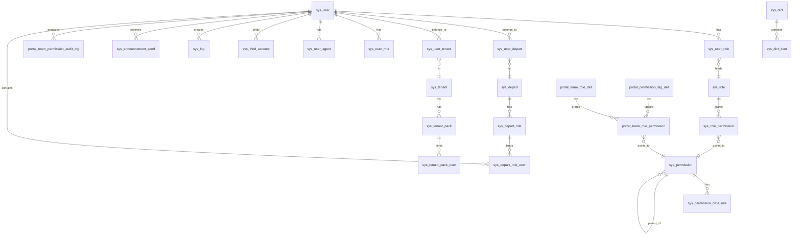

# 数据架构

> Star AI Boot 基于 MySQL 8.4.0 构建，采用 **同库多租户** 隔离模式，通过 MyBatis-Plus `TenantLineInnerInterceptor` 实现行级隔离。

---

## 一、数据库技术选型

| 项 | 值 | 说明 |
|----|-----|------|
| 主数据库 | MySQL 8.4.0 | 主从读写分离（可选） |
| JDBC 驱动 | `com.mysql:mysql-connector-j` 8.4.0 | 官方驱动，修复 CVE-2023-22102 |
| ORM | MyBatis-Plus 3.5.5 | 自动 CRUD + 租户注入 + 逻辑删除 |
| 连接池 | HikariCP + Druid 1.2.22 | Hikari (主用高性能) + Druid (SQL 防火墙/监控) |
| 多租户 | `TenantLineInnerInterceptor` | 行级隔离，自动注入 `WHERE tenant_id = ?` |
| 读写分离 | `dynamic-datasource-spring-boot-starter` 4.3.1 | 可扩展 |
| 分布式事务 | Seata AT 2.0.0 | 跨服务事务 |
| 数据库迁移 | Flyway | 版本化 DDL，`db/flyway/V{version}__{name}.sql` |
| 字符集 | utf8mb4 | 支持 emoji + 全语言 |

---

## 二、核心数据表一览

### 2.1 系统域 (sys_*)

| 表名 | 模块 | 说明 |
|------|------|------|
| `sys_user` | system | 用户主表 |
| `sys_user_agent` | system | 用户可信设备 (WebAuthn/MFA) |
| `sys_user_mfa` | system | MFA 配置 (TOTP seed 加密存储) |
| `sys_user_role` | system | 用户-角色关联 |
| `sys_user_depart` | system | 用户-部门关联 |
| `sys_user_tenant` | system | 用户-租户关联 |
| `sys_user_fee_config` | system | 用户计费配置 |
| `sys_user_safe_query` | system | 用户安全查询 |
| `sys_role` | system | 角色 |
| `sys_role_permission` | system | 角色-权限关联 |
| `sys_role_index` | system | 角色首页配置 |
| `sys_permission` | system | 权限点 (菜单+按钮) |
| `sys_permission_data_rule` | system | 数据权限规则 |
| `sys_depart` | system | 部门 |
| `sys_depart_role` | system | 部门角色 |
| `sys_depart_role_user` | system | 部门角色-用户关联 |
| `sys_depart_permission` | system | 部门-权限关联 |
| `sys_position` | system | 职位 |
| `sys_dict` / `sys_dict_item` | system | 字典 |
| `sys_announcement` | system | 公告 |
| `sys_announcement_send` | system | 公告发送记录 |
| `sys_log` | system | 操作日志 |
| `sys_data_log` | system | 数据变更日志 |
| `sys_gateway_route` | system | 网关路由配置 |
| `sys_tenant` | system | 租户 |
| `sys_tenant_pack` | system | 租户套餐包 |
| `sys_tenant_pack_user` | system | 套餐包用户关联 |
| `sys_third_account` | system | 第三方账号绑定 (GitHub/微信) |
| `sys_third_app_config` | system | 第三方应用配置 |
| `sys_datasource` | system | 动态数据源配置 |
| `sys_check_rule` | system | 编码规则 |
| `sys_fill_rule` | system | 填充规则 |
| `sys_category` | system | 分类 |
| `sys_form_file` | system | 表单文件 |
| `sys_table_white_list` | system | 动态表名白名单 |
| `sys_deny_audit` | system | 禁止调用审计 |
| `sys_comment` | system | 评论 |

### 2.2 Portal 团队扩展表 (portal_*)

| 表名 | 模块 | 说明 |
|------|------|------|
| `portal_team_role_def` | team | 团队自定义角色 |
| `portal_team_role_permission` | team | 团队角色权限 |
| `portal_permission_tag_def` | team | 权限标签定义 |
| `portal_team_permission_audit_log` | team | 权限审计日志 |

### 2.3 消息与文件

| 表名 | 模块 | 说明 |
|------|------|------|
| `sys_message` | system | 站内消息 |
| `sys_message_template` | system | 消息模板 |
| `sys_template_edit_log` | system | 模板编辑日志 |
| `oss_file` | system | OSS 文件记录 |

### 2.4 AI 业务域 (待落地)

| 表名 | 模块 | 建议说明 |
|------|------|---------|
| `ai_provider` | provider | AI 厂商配置 |
| `ai_channel` | provider | API 通道 (AK/SK 加密) |
| `ai_model` | provider | 模型元数据 |
| `ai_generation` | generate | 生成任务记录 |
| `ai_task` | task | 异步任务 (五态流转) |
| `ai_asset` | content | 素材库 (角色/场景/道具) |
| `ai_script` | content | AI 剧本 |
| `ai_storyboard` | content | 分镜 |
| `ai_storyboard_project` | content | 分镜项目 |
| `ai_billing` | billing | 账单 |
| `ai_usage_record` | billing | 用量记录 |

### 2.5 🆕 18+ 视频付费分润域 (stream / creator / payment) · **v1.2.1 最新**

> **v1.2.1 最新变更**：会员权益体系完善（充值送积分 + 全局免费集数 + 会员集级/秒级扩展）+ 三级定价层级 + 五种消费路径 + 创作者独立抽成比例 + 剧集 Series 多季支持
> **v1.1 变更**：新增会员订阅池分润模式（Netflix 式），与原有交易驱动模式并存。
> `stream_revenue_record.revenue_source` 区分 DIRECT（单视频付费）/ SUBSCRIPTION_POOL（订阅池月度分摊）。

| 表名 | 模块 | 说明 |
|------|------|------|
| `sys_user_age_verification` | system (扩展) | 用户年龄验证 (注册强制 18+ 合规) |
| `creator_account` | creator | 创作者账户 + 等级 + **固定点数抽成比例独立可配** + **三级定价区间独立配置** (`price_amount_min/max` 单集 + `series_price_min/max` 剧集 + `global_unlock_price_min/max` 全局) + **`global_unlock_price` 创作者自己定价全局解锁** |
| `creator_video_category` | creator | 视频分类（平台维护） |
| `creator_video_tag` | creator | 视频标签 |
| `stream_video` | stream | 视频资源（核心：存储路径/**每集独立定价**`price_amount`/审核/统计/**抽成快照`revenue_rate_snapshot` v1.2 新增**） |
| `stream_video_tag_rel` | stream | 视频-标签 多对多 |
| `stream_video_collection` | stream | 视频合集（短剧/连续剧 + **全集打包解锁**`price_amount` / 单集参考价 `episode_unit_price` v1.2） |
| `stream_video_collection_rel` | stream | 合集-视频关联 |
| `stream_video_purchase` | stream | 观看权限（4 种路径：单集购买 / 合集全集解锁**v1.2** / 会员权益 / 赠送；`unlock_scope` 区分 episode/collection） |
| `stream_video_play_history` | stream | 播放历史（断点续播 + **订阅池贡献埋点 `is_effective`/`completion_rate`/`is_member_view` v1.1 新增**） |
| `stream_video_interaction` | stream | 点赞收藏 |
| `stream_revenue_record` | stream | **分润收益流水 · 双轨**：`revenue_source=DIRECT` 交易驱动（支付成功后 MQ 异步写入）/ `revenue_source=SUBSCRIPTION_POOL` 订阅池驱动（月度 XXL-JOB 跑批写入） |
| `stream_withdrawal_request` | stream | 创作者提现申请 |
| `stream_creator_earnings` | stream | 创作者收益账本（汇总表，加速看板查询） |
| **`stream_subscription_plan`** 🆕 | stream | 会员订阅方案（月/季/年/试用，含订阅池财务参数 + 贡献度算法参数） |
| **`stream_user_subscription`** 🆕 | stream | 用户订阅记录（谁、什么时候、什么方案、自动续费、状态） |
| **`stream_subscription_pool`** 🆕 | stream | **每月订阅分润总池**（核心对账锚点：汇总订阅收入 + 全平台贡献度 + 方案参数快照） |
| **`stream_creator_monthly_contribution`** 🆕 | stream | 每月创作者订阅贡献度（贡献分 + 贡献百分比 + 分得金额） |
| **`stream_creator_unlock`** 🆕 | stream | **创作者全局解锁记录 v1.2**（独立表，UNIQUE user_id+creator_id，解锁后该 creator 所有视频永久可看含未来新发布；支付成功分润走 DIRECT 但 video_id=NULL） |
| **`stream_platform_config`** 🆕 | stream | **平台级配置 v1.2.1**（`free_episodes_per_series` 全局免费集数 + 后续 stream 域全局配置，独立表避免污染 sys_dict） |
| `ai_payment_order` | payment | 支付订单（公共服务，`business_type` 扩展 `stream_subscription_purchase`/`stream_subscription_renew`/`stream_subscription_cancel_refund` v1.1 新增） |
| `ai_payment_channel` | payment | 支付渠道配置（微信/支付宝/Stripe/Paddle · Paddle 支持 SaaS 订阅自动续费） |
| `ai_payment_refund` | payment | 退款单 |
| `ai_payment_settlement` | payment | 每日对账 |

> **详细 DDL**：参见 [schema/08_stream_creator_domain.sql v1.2] + [schema/10_subscription_pool_domain.sql v1.2.1](schema/08_stream_creator_domain.sql) + [schema/10_subscription_pool_domain.sql (v1.1 新增)](schema/10_subscription_pool_domain.sql) + [schema/09_payment_domain.sql](schema/09_payment_domain.sql)

---

## 三、实体关系图（核心）



---

## 四、多租户实现细节

### 4.1 TenantLineInnerInterceptor 配置

```java
// star-ai-boot-base-core · org.jeecg.config.mybatis.MybatisPlusSaasConfig
@Bean
public MybatisPlusInterceptor mybatisPlusInterceptor() {
    MybatisPlusInterceptor interceptor = new MybatisPlusInterceptor();
    interceptor.addInnerInterceptor(new TenantLineInnerInterceptor(new JeecgTenantParser()));
    // ...
    return interceptor;
}
```

### 4.2 JeecgTenantParser 实现

```java
// star-ai-boot-base-core · org.jeecg.config.mybatis.JeecgTenantParser
implements TenantLineHandler {
    @Override
    public Expression getTenantId() {
        // 从 TenantContext ThreadLocal 读取
        return new LongValue(TenantContext.getTenantId());
    }
    @Override
    public String getTenantIdColumn() {
        return "tenant_id";
    }
    @Override
    public boolean ignoreTable(String tableName) {
        // 系统表 (sys_dict, sys_permission) 和不隔离表 (sys_tenant 自身) 跳过
        return TENANT_IGNORE_TABLES.contains(tableName);
    }
}
```

### 4.3 TenantContext 注入链路

```
HTTP Request (Header: X-Tenant-Id / Cookie / JWT Claim)
  │
  ▼
TenantContextInboundFilter     ← 网关入口 filter
  │  ThreadLocal.set(tenantId)
  ▼
Sa-Token 鉴权成功
  │  将 tenantId 写入 SaSession
  ▼
Mybatis-Plus TenantParser
  │  读取 ThreadLocal → 自动注入 WHERE tenant_id = ?
  ▼
DB 查询执行
  │
  ▼
Request 结束 → filter finally 清理 ThreadLocal
```

### 4.4 租户隔离边界

| 边界 | 说明 |
|------|------|
| **表级别白名单** | 只有标记 `tenant_id` 字段的表才启用租户过滤 |
| **超级管理员** | sys_user.user_type = '1' (admin) 时绕过租户隔离 |
| **系统平台表** | sys_dict / sys_permission / sys_gateway_route 等共享表不隔离 |
| **动态表** | sys_table_white_list 管理允许的动态表名 |

---

## 五、索引策略

### 5.1 必加索引

| 表 | 字段 | 类型 | 场景 |
|----|------|------|------|
| `sys_user` | (username) | UNIQUE | 登录查询 |
| `sys_user` | (phone) | INDEX | 手机登录 |
| `sys_user_role` | (user_id, role_id) | INDEX | N:N 查询 |
| `sys_role_permission` | (role_id, permission_id) | INDEX | N:N 查询 |
| `sys_user_tenant` | (user_id, tenant_id) | UNIQUE | 多租户绑定 |
| `sys_tenant_pack_user` | (pack_id) | INDEX | 套餐包查用户 |
| `sys_log` | (create_by, create_time) | INDEX | 操作日志按人/时间查 |
| `sys_announcement_send` | (announcement_id, user_id) | INDEX | 公告发送记录 |

### 5.2 租户字段索引

所有业务表 **必须** 为 `tenant_id` 建立索引（最好复合索引 `(tenant_id, 业务字段)`）：

```sql
CREATE INDEX idx_user_tenant_id ON sys_user(tenant_id);
CREATE INDEX idx_role_tenant_id ON sys_role(tenant_id);
CREATE INDEX idx_generation_tenant_id ON ai_generation(tenant_id, status, create_time);
```

### 5.3 慢查询防护

```yaml
# star-ai-boot-base-core · DruidConfig
druid:
  stat-view-servlet:
    enabled: true
    url-pattern: /druid/*
  filter:
    stat:
      enabled: true
      log-slow-sql: true
      slow-sql-millis: 2000
      merge-sql: true
    wall:
      enabled: true
      config:
        multi-statement-allow: false
        comment-allow: false
        system-command-allow: false
```

---

## 六、Flyway 数据库迁移

### 6.1 迁移版本号约定

```
V{version}__{description}.sql
  │         │
  │         └── 描述 (下划线分词)
  └── 版本号 (主版本.次版本.修订号)
```

### 6.2 示例

```
db/flyway/
  V1_99_020__D4_mfa_legacy_cutoff.sql
  V1_99_021__D11_audit_apikey_at_rest_sm4.sql
  V1_99_022__D12_revoke_dba_file_process.sql
  V1_99_023__C1_seed_roles_permissions.sql
  V1_99_024__E5_template_status.sql
  V1_99_025__H6_deny_audit_log_retention.sql
  V1_99_026__seed_security_GHCJ_new_permissions.sql
  V1_99_028__operations_admin_dict_item_grant.sql
  V1_99_029__revoke_user_crud_from_operations_admin.sql
```

### 6.3 启动时自动执行

```java
// star-ai-system-cloud-start · JeecgSystemCloudApplication
@SpringBootConfiguration
@Import(NewFeignConfig.class)
@EnableScheduling
public class JeecgSystemCloudApplication extends SpringBootServletInitializer {
    // Spring Boot 3.3.x 默认集成 Flyway，启动时自动扫描 classpath:db/flyway
}
```

---

## 七、Redis 数据结构

### 7.1 Token 存储 (Sa-Token)

```
sa-token:login:{device}:{userId}       → String (tokenValue, TTL=7d)
sa-token:session:{tokenValue}          → Hash (userId, roleList, tenantId, ...)
sa-token:permission:{userId}            → Set (权限码列表)
sa-token:role:{userId}                 → Set (角色 code 列表)
```

### 7.2 分布式锁 (Redisson)

```
lock:{businessKey}                     → Redisson Lock (可重入)
```

### 7.3 队列 (Bull 协议)

```
bull:queue:{queueName}:wait            → List (等待任务)
bull:queue:{queueName}:active          → List (执行中)
bull:queue:{queueName}:completed       → ZSet (完成任务 + 时间戳)
bull:queue:{queueName}:failed          → ZSet (失败任务 + 错误信息)
bull:queue:{queueName}:delayed         → ZSet (延迟任务)
```

### 7.4 缓存

```
cache:dict:{dictCode}                  → String (JSON 字典项列表)
cache:tenant_permission:{tenantId}     → Set (租户权限树)
cache:role_permission:{roleId}         → Set (角色权限点)
cache:user_online:{userId}             → String (在线时间戳, TTL=2h)
```

### 7.5 发布订阅

```
topic:router-refresh                   → Gateway 路由变更通知
topic:auth-state                       → 权限变更广播
topic:user-logout                      → 用户强制下线广播
```

---

## 八、RabbitMQ 消息拓扑

### 8.1 vhost 隔离

```
/vhost_root                        (开发环境)
  jeecg-system
  star-ai-generate
  star-ai-task
  star-ai-billing

/mightyPay/{serviceName}           (生产环境，每服务独立 vhost)
  专用 user + 专用 queue/exchange
```

### 8.2 典型 Exchange/Queue 映射

| Exchange | Queue | 生产者 | 消费者 | Routing Key |
|----------|-------|--------|--------|-------------|
| `x.direct.auth-state` | `q.auth-state.invalidate` | system | 所有业务服务 | `auth.invalidate` |
| `x.direct.user-logout` | `q.user-logout.broadcast` | system | gateway | `user.logout` |
| `x.direct.billing` | `q.billing.deduct` | generate | billing | `billing.deduct` |
| `x.direct.billing` | `q.billing.refund` | generate | billing | `billing.refund` |
| `x.direct.task` | `q.task.create` | generate | task | `task.create` |
| `x.direct.notification` | `q.notification.email` | system | mailer | `notify.email` |
| `x.direct.notification` | `q.notification.websocket` | generate | task | `notify.ws` |
| 🆕 `x.direct.video` | `q.video.uploaded` | creator | stream | `video.uploaded` |
| 🆕 `x.direct.video` | `q.video.transcode` | stream | transcode-worker | `video.transcode` |
| 🆕 `x.direct.payment` | `q.payment.success` | payment | stream | `payment.success` |
| 🆕 `x.direct.payment` | `q.payment.notify` | payment | 各业务方 | `payment.notify` |
| 🆕 `x.direct.settlement` | `q.settlement.monthly` | stream | stream (self) | `settlement.monthly` |
| 🆕 v1.1 `x.direct.stream` | `q.subscription.payment.success` | payment | stream | `subscription.payment.success` (用户订阅支付成功, 激活 user_subscription) |
| 🆕 v1.1 `x.direct.stream` | `q.video.member_watched` | stream | stream (self) | `video.member_watched` (会员有效播放结束, 增量贡献 Redis) |
| 🆕 v1.1 `x.direct.stream` | `q.subscription.expire` | stream | stream (self) | `subscription.expire.check` (每日 XXL-JOB 触发, 自动续费/到期提醒) |

---

## 九、对象存储 (MinIO)

### 9.1 Bucket 规划

| Bucket | 用途 | 目录结构 |
|--------|------|---------|
| `user-uploads` | 用户原始上传 | `/{tenantId}/{userId}/{yyyy}/{mm}/{fileId}` |
| `ai-generated` | AI 生成结果 | `/{tenantId}/{userId}/{generationId}/{filename}` |
| `ai-assets` | 素材库 | `/{tenantId}/{assetType}/{assetId}` |
| `system-files` | 系统文件 | `/system/{filename}` |
| `temp-files` | 临时文件 (24h 自动清理) | `/{hash}` |
| 🆕 `stream-creator-draft` | 创作者视频暂存区 | `creator/{creator_id}/{uuid}.{ext}` |
| 🆕 `stream-published` | 已上架视频区 (18+ 内容) | `video/{video_id}/original.mp4` / `hls/**` |
| 🆕 `stream-temp` | 转码/分片临时 (24h) | `{hash}.tmp` |

**国际版扩展**: AWS S3 (ap-southeast-1 / us-east-1) 使用相同 bucket 命名 + region 后缀:
`stream-creator-draft-{region}` / `stream-published-{region}` / `stream-temp-{region}`

### 9.2 🆕 视频内容存储策略（18+ 专用）

```
全平台都是 18+ 内容，不需要 safe/adult 双 bucket。

创作者上传 (直传 MinIO presigned URL)
    │
    ▼
stream-creator-draft        ← 仅 creator-service 服务端签名访问
    │
    │  自动审核 (NSFW)
    │  转码 FFmpeg → HLS 多码率
    ▼
审核通过 → COPY 到 stream-published
    │
    ▼
stream-published            ← 全部走签名 URL，不允许公开访问
    │
    ├── 国内:  MinIO presigned URL (15min + IP 绑定 + Referer 防盗链)
    └── 国际:  CloudFront Signed URL (15min + IP 绑定 + video_id 内嵌)
               + S3 Bucket Policy 拒绝所有公开访问
               + CloudFront Geo-Restriction 屏蔽违规国家

生命周期:
    - stream-creator-draft: 审核通过后清理源文件；驳回/过期 30 天自动清理
    - stream-published:     下架后保留 30 天再清理
    - stream-temp:          24 小时自动清理
```

### 9.3 上传流程 (已有)

```
Client
  │  POST /oss/upload (multipart/form-data)
  ▼
System Service
  │  1. 校验文件类型 (ContentValidator)
  │  2. 生成 fileId (雪花 ID)
  │  3. 计算存储路径
  │  4. 调用 MinIO SDK 上传
  │  5. 记录 oss_file 表
  ▼
返回 { fileId, url }
```

### 9.4 🆕 视频直传流程（创作者专用）

```
Creator Client
  │ 1. GET /creator/videos/upload-init { filename, size }
  │
  ▼
Creator Service
  │ 2. 校验创作者状态 (active)
  │ 3. 校验文件大小/类型 (ContentValidator)
  │ 4. 生成 uploadId + 分片 presigned URLs
  │
  ▼
Creator Client
  │ 5. 直传分片到 stream-creator-draft (MinIO presigned URL)
  │    （绕开网关，减少流量压力）
  │ 6. POST /creator/videos/{id}/complete
  │
  ▼
Creator Service
  │ 7. 合并分片
  │ 8. 提取元数据 (时长/分辨率/大小)
  │ 9. 创建 stream_video record (status=pending_transcode)
  │ 10. 投递 MQ: video.uploaded
  │
  ▼
Transcode Worker (consume)
  │ 11. FFmpeg HLS 多码率转码
  │ 12. 自动审核 NSFW
  │ 13. 审核通过 → COPY draft → stream-published
  │ 14. 更新 stream_video status=pending_review
  │
  ▼
Admin 审核
  │ 15. POST /internal/stream/review/{videoId}/approve
  │ 16. stream_video.status = published
```
